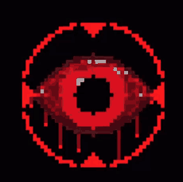
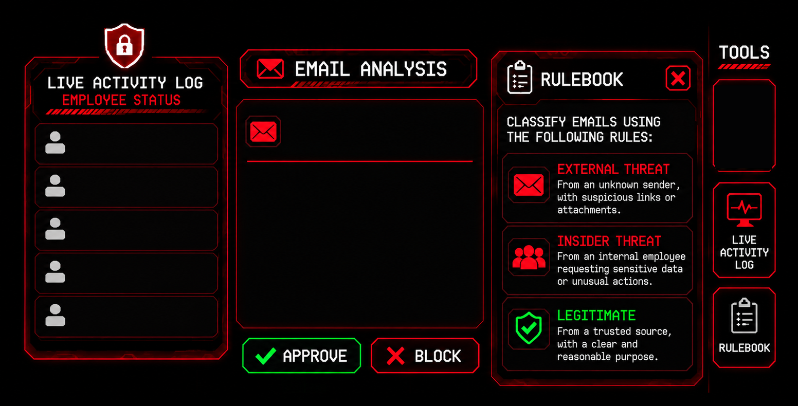

  

  <h1>B L O O D S H O T</h1>

  
<i>Every system has a weakness. Who will find it first?</i>

  <code>PHASER 3</code> &nbsp; / &nbsp;
  <code>JAVASCRIPT</code> &nbsp; / &nbsp;
  <code>CYBERSECURITY</code> &nbsp; / &nbsp;
  <code>2D GAME</code>

 

<h2>01 — About the Game</h2>

BLOODSHOT is a 2D cybersecurity game that explores
a security incident from two opposing perspectives:
a cybersecurity analyst protecting a company and
a former employee attempting to compromise its system.

The game combines storytelling, interactive challenges,
email analysis, identity verification, and cryptography
within a dark, pixel-art-inspired environment.

Rather than presenting cybersecurity concepts through
traditional questions, BLOODSHOT allows players to
experience them through decisions and their consequences.

---

<h2>02 — The Story</h2>

After being dismissed from the company, a former
employee begins planning his revenge.

He collects information about his manager, searching
for weaknesses that could allow him to bypass the
company's security system.

Meanwhile, the cybersecurity analyst at RADXIS
is responsible for monitoring employee activity,
investigating suspicious emails, and preventing
potential security breaches.

Two different perspectives.
Two different objectives.
One company at risk.

---

<h2>03 — Choose Your Role</h2>

<h3>Cybersecurity Analyst</h3>

The analyst is responsible for protecting RADXIS
against internal and external security threats.

Players investigate incoming emails and decide
whether each message should be approved or blocked.

  

   
  The Analyst Workspace

 

#### Email Analysis

The analyst receives ten different emails divided
into three categories:

- 3 insider threats
- 4 external phishing attempts
- 3 legitimate messages

Each email contains information such as the sender,
subject, message content, and attachments or links.

Players must examine these details before making
a security decision.

#### Deep ID Scanner

An interactive investigation tool that can be dragged
over an email to verify whether it is trusted or untrusted.

The scanner has a limited energy supply of three uses,
encouraging players to investigate carefully rather
than relying on the tool for every decision.

The scanner includes:

- Drag-and-drop interaction.
- Animated scanning effects.
- Green and red verification indicators.
- Battery consumption and energy tracking.
- An animated eye that reacts to scan results.

#### Live Activity Log

A continuously updated monitoring panel that displays
simulated employee activity within the company.

The log provides additional context through employee
IDs, activity records, online indicators, and alerts
for suspicious behavior.

#### Security Rulebook

An interactive reference panel containing guidelines
for identifying insider threats, external phishing,
and legitimate communication.

The panel can be opened or closed, allowing the
email workspace to expand when additional reading
space is needed.

#### Decision System

Each classification affects the player's progress.

Correct decisions allow the analyst to continue,
while incorrect decisions increase the mistake counter.

Approving a malicious message triggers a visual
security breach effect, including a hammer impact
and screen cracks.

The analyst must complete all ten messages without
reaching three mistakes.

---

<h3>Hacker</h3>

The hacker follows a different path, attempting
to gain unauthorized access to the company's system.

This role focuses on identity verification,
security challenges, and cryptography.

#### The Backstory

Before entering the system, the player discovers
three pieces of information connected to the manager:

- A discarded coffee cup.
- A voice recording.
- A photograph.

These clues form part of the hacker's storyline
and introduce the identity verification challenges.

#### Identity Verification

The player progresses through interactive
verification stages using simulated identity samples.

Correct selections unlock the next stage, while
incorrect selections display access-denied feedback.

#### Security Question

After completing the verification stages, the
player must answer a security question to unlock
the manager's account.

#### The Final Cipher

The final challenge introduces a Caesar cipher puzzle.

The player must decode the encrypted information
and submit the correct answer before the timer expires.

Solving the puzzle grants access to the system.
Running out of time triggers a security alert.

---

<h2>04 — The Game Experience</h2>

BLOODSHOT was developed as a sequence of connected
interactive scenes rather than a single game screen.

The experience begins with an animated eye and
a role-selection menu, followed by a desktop
environment that introduces the selected path.

  <pre>
           MAIN MENU
               |
          DESK SCENE
               |
      +--------+--------+
      |                 |
   ANALYST            HACKER
      |                 |
      +--------+--------+
               |
        NOTIFICATION
               |
           END SCENE
  </pre>

Each path includes its own interface, interactions,
challenges, feedback, and possible outcomes.

---

<h2>05 — Visual Design</h2>

The visual identity of BLOODSHOT was designed around
a dark cybersecurity atmosphere.

The interface combines black backgrounds, red warning
indicators, green verification feedback, pixel-art
elements, and animated visual effects.

Visual features include:

- Animated eye introduction.
- Interactive desktop environments.
- Custom cybersecurity dashboard.
- Matrix-inspired hacker background.
- Scanner glow and verification animations.
- Hammer impact and screen-cracking effects.
- Security notifications and result screens.

The visual feedback changes according to the
player's actions throughout the game.

---

<h2>06 — Game Outcomes</h2>

| Role | Successful Outcome | Failed Outcome |
| :--- | :--- | :--- |
| Analyst | SYSTEM SECURED | YOU ARE FIRED |
| Hacker | ACCESS GRANTED | SECURITY ALERT |

The final outcome depends on the player's
performance throughout the selected path.

Players can return to the main menu and experience
the incident from the opposite perspective.

---

<h2>07 — Behind the Development</h2>

The project was developed using Phaser 3 and
JavaScript, with separate scenes responsible for
different stages of the game.

The development process included:

- Designing and implementing the game interfaces.
- Creating interactive email classification mechanics.
- Developing identity verification challenges.
- Implementing a timed cryptography puzzle.
- Managing game states and scene transitions.
- Creating custom animations and visual feedback.
- Organizing email scenarios using JSON.
- Loading embedded animation frames as game textures.
- Integrating multiple game components into one experience.

The project was developed collaboratively, with
individual responsibilities distributed across
game mechanics, interfaces, assets, shared utilities,
and scene management.

---

<h2>08 — Project Structure</h2>

    bloodshot/
    |
    +-- assets/
    |   +-- images/
    |   +-- Story assets
    |
    +-- js/
    |   +-- data/
    |   |   +-- messages.json
    |   |   +-- videoData.js
    |   |   +-- deskData.js
    |   |   +-- notifyData.js
    |   |
    |   +-- scenes/
    |   |   +-- BootScene.js
    |   |   +-- MenuScene.js
    |   |   +-- DeskScene.js
    |   |   +-- AnalystScene.js
    |   |   +-- HackerScene.js
    |   |   +-- NotifyScene.js
    |   |   +-- EndScene.js
    |   |
    |   +-- config.js
    |   +-- main.js
    |
    +-- index.html
    +-- README.md

The scene-based architecture separates the game's
interfaces and mechanics, while external data files
store messages and animation assets.

---

<h2>09 — Technologies</h2>

  
  
  
  
  

---

<h2>10 — Run the Game</h2>

1. Clone or download the repository.
2. Open the `bloodshot` folder in Visual Studio Code.
3. Launch `index.html` using the Live Server extension.
4. Select either the Analyst or Hacker role.

No additional package installation is required.
An internet connection is required to load Phaser
from the CDN used by the main HTML file.

 

---

  <h2>B L O O D S H O T</h2>

  
<i>Protect the system. Or become its weakness.</i>

  A collaborative cybersecurity game project.

